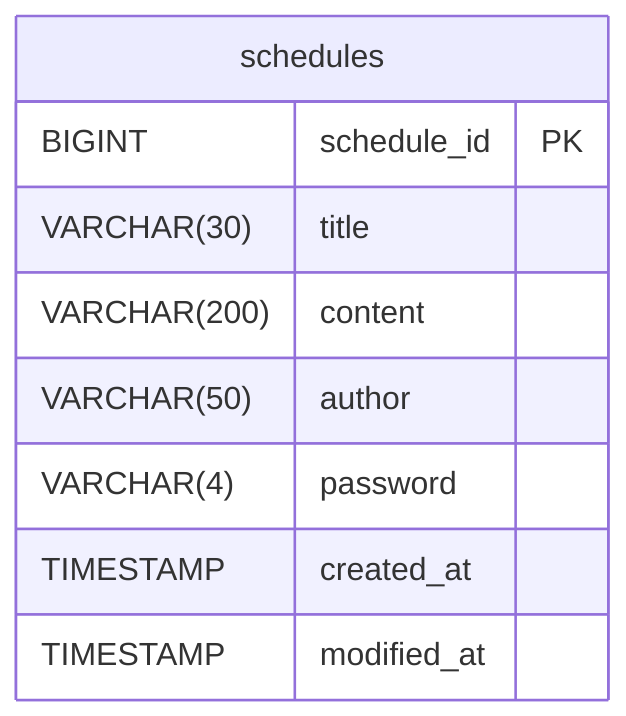

## API 명세서

### 일정(schedule)

|Method|URI|기능|
|--|--|--|
|POST|`/api/v1/schedules`|일정 생성|
|GET|`/api/v1/schedules`|전체 일정 조회|
|GET|`/api/v1/schedules/{scheduleId}`|선택 일정 조회|
|PATCH|`/api/v1/schedules/{scheduleId}`|선택 일정 수정|
|DELETE|`/api/v1/schedules/{scheduleId}`|선택 일정 삭제|

<details>
<summary><h3>일정 생성</h3></summary>

|메서드|요청 URL|
|--|--|
|POST|`/api/v1/schedules`

**Request Headers**

|Key|Value|필수|설명|
|--|--|--|--|
|`Content-Type`|`application/json`|✅|요청 본문 형식|

**Request Body**

|필드|타입|필수|설명|
|--|--|--|--|
|`title`|String|✅| 일정 제목 
|`content`|String|✅| 일정 내용
|`author`|String|✅| 작성자명
|`password`|String|✅| 비밀번호

```json
{
    "title": "일정 제목",
    "content": "일정 내용",
    "author": "작성자명",
    "password": "1234"
}
```
**Response Body** `201 Created`

|필드|타입|설명|
|--|--|--|
|`scheduleId`|Long|일정 ID|
|`title`|String|일정 제목|
|`content`|String|일정 내용|
|`author`|String|작성자명|
|`createdAt`|LocalDateTime|작성일
|`modifiedAt`|LocalDateTime|수정일

```json
{
    "scheduleId": 1,
    "title": "일정 제목",
    "content": "일정 내용",
    "author": "작성자명",
    "createdAt": "2026-10-16T14:30:00",
    "modifiedAt": "2026-10-16T14:30:00"
}
```

</details>

<details>
<summary><h3>전체 일정 조회</h3></summary>

|메서드|요청 URL|
|--|--|
|GET|`/api/v1/schedules`

**Query Parameter**

|필드|타입|필수|설명|
|--|--|--|--|
|`author`|String|❌| 작성자명

**Response Body** `200 OK`

|필드|타입|설명|
|--|--|--|
|`scheduleId`|Long|일정 ID|
|`title`|String|일정 제목|
|`content`|String|일정 내용|
|`author`|String|작성자명|
|`createdAt`|LocalDateTime|작성일
|`modifiedAt`|LocalDateTime|수정일

```json
{
    "scheduleList": [
        {
            "scheduleId": 1,
            "title": "제목",
            "content": "내용",
            "author": "작성자",
            "createdAt": "2026-11-14T17:09:00",
            "modifiedAt": "2026-11-14T17:09:00"
        },
        {
            "scheduleId": 2,
            "title": "제목",
            "content": "내용",
            "author": "작성자",
            "createdAt": "2026-09-14T17:09:00",
            "modifiedAt": "2026-09-14T17:09:00"
        },
        {
            "scheduleId": 3,
            "title": "제목",
            "content": "내용",
            "author": "작성자",
            "createdAt": "2026-10-08T17:09:00",
            "modifiedAt": "2026-10-08T17:09:00"
        },
        {
            "scheduleId": 4,
            "title": "제목",
            "content": "내용",
            "author": "작성자",
            "createdAt": "2026-10-07T17:09:00",
            "modifiedAt": "2026-10-07T17:09:00"
        }
    ]
}
```

</details>

<details>
<summary><h3>선택 일정 조회</h3></summary>

|메서드|요청 URL|
|--|--|
|GET|`/api/v1/schedules/{scheduleId}`

**Response Body** `200 OK`

|필드|타입|설명|
|--|--|--|
|`scheduleId`|Long|일정 ID|
|`title`|String|일정 제목|
|`content`|String|일정 내용|
|`author`|String|작성자명|
|`createdAt`|LocalDateTime|작성일
|`modifiedAt`|LocalDateTime|수정일

```json
{
    "scheduleId": 2,
    "title": "제목",
    "content": "내용",
    "author": "작성자",
    "createdAt": "2026-09-14T17:09:00",
    "modifiedAt": "2026-09-14T17:09:00"
}
```

</details>

<details>
<summary><h3>일정 수정</h3></summary>

|메서드|요청 URL|
|--|--|
|PATCH|`/api/v1/schedules/{scheduleId}`

**Request Headers**

|Key|Value|필수|설명|
|--|--|--|--|
|`Content-Type`|`application/json`|✅|요청 본문 형식|

**Request Body**

|필드|타입|필수|설명|
|--|--|--|--|
|`title`|String|❌| 일정 제목
|`author`|String|❌| 작성자명
|`password`|String|✅| 비밀번호

```json
{
    "title": "일정 제목",
    "author": "작성자명",
    "password": "1234"
}
```
**Response Body** `200 OK`

|필드|타입|설명|
|--|--|--|
|`scheduleId`|Long|일정 ID|
|`title`|String|일정 제목|
|`content`|String|일정 내용|
|`author`|String|작성자명|
|`createdAt`|LocalDateTime|작성일
|`modifiedAt`|LocalDateTime|수정일

```json
{
    "scheduleId": 1,
    "title": "일정 제목",
    "content": "일정 내용",
    "author": "작성자명",
    "createdAt": "2026-10-15T09:00:00",
    "modifiedAt": "2026-10-16T14:30:00"
}
```

</details>

<details>
<summary><h3>일정 삭제</h3></summary>

|메서드|요청 URL|
|--|--|
|DELETE|`/api/v1/schedules/{scheduleId}`

**Request Headers**

|Key|Value|필수|설명|
|--|--|--|--|
|`Content-Type`|`application/json`|✅|요청 본문 형식|

**Request Body**

|필드|타입|필수|설명|
|--|--|--|--|
|`password`|String|✅| 비밀번호

```json
{
    "password": "1234"
}
```

**Response** `204 No Content`

</details>

## ERD


## 테이블 명세서

### 공통 컬럼: `BaseEntity`

|칼럼 이름| 데이터타입|null 허용| key종류| 기본값| 설명|
|--|--|--|--|--|--|
|`created_at`|TIMESTAMP|❌|-|-|작성일 (최초 저장 시 자동 입력, 수정 불가)|
|`modified_at`|TIMESTAMP|❌|-|-|수정일 (저장·수정 시 자동 갱신)|

### 테이블명: `Schedule`
|칼럼 이름| 데이터타입|null 허용| key종류| 기본값| 설명|
|--|--|--|--|--|--|
|`schedule_id`|BIGINT|❌|PK|AUTO_INCREMENT|일정 ID|
|`title`|VARCHAR(30)|❌|-|-|일정 제목|
|`content`|VARCHAR(200)|❌|-|-|일정 내용|
|`author`|VARCHAR(50)|❌|-|-|작성자명|
|`password`|VARCHAR(4)|❌|-|-|비밀번호|
|`created_at`|TIMESTAMP|❌|-|-|작성일 (`BaseEntity` 상속)|
|`modified_at`|TIMESTAMP|❌|-|-|수정일 (`BaseEntity` 상속)|