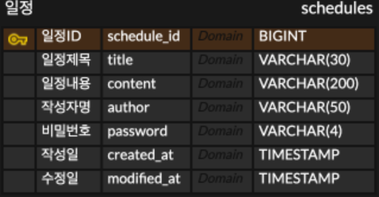

## ERD


## API 명세서
https://documenter.getpostman.com/view/50157289/2sBYHRVh9Z?utm_source=postman-app

# API 명세서

## 일정(schedule)

|Method|URI|기능|
|--|--|--|
|POST|`api/v1/schedules`|일정 생성|
|GET|`api/v1/schedules`|전체 일정 조회|
|GET|`api/v1/schedules`|선택 일정 조회|
|PATCH|`api/v1/schedules/{scheduleId}`|선택 일정 수정|
|DELETE|`api/v1/schedules/{scheduleId}`|선택 일정 삭제|

### 일정 생성

|메서드|요청 URL|
|--|--|
|POST|`api/v1/schedules`

**Request Headers**

|Key|Value|필수|설명|
|--|--|--|--|
|`Content-Type`|`application/json`|Y|요청 본문 형식|

**Request Body**

|필드|타입|필수|설명|
|--|--|--|--|
|`title`|String|Y| 일정 제목 
|`content`|String|Y| 일정 내용
|`author`|String|Y| 작성자명
|`password`|String|Y| 비밀번호

```json
{
    "title": "일정 제목",
    "content": "일정 내용",
    "author": "작성자명",
    "password": "1234"
}
```
**Response Body** `201 Created`

|필드|타입|필수|유효성|
|--|--|--|--|
|`scheduleId`|Long|Y|일정 ID|
|`title`|String|Y|일정 제목|
|`content`|String|Y|일정 내용|
|`author`|String|Y|작성자명|
|`createdAt`|LocalDateTime|Y|작성일
|`modifiedAt`|LocalDateTime|Y|수정일

```json
{
    "scheduledId": 1,
    "title": "일정 제목",
    "content": "일정 내용",
    "author": "작성자명",
    "createdAt": "작성일",
    "modifiedAt": "수정일"
}
```

### 전체 일정 조회

|메서드|요청 URL|
|--|--|
|GET|`api/v1/schedules`

**Query Parameter**

|필드|타입|필수|설명|
|--|--|--|--|
|`author`|String|N| 작성자명

**Response Body** `200 OK`

|필드|타입|필수|유효성|
|--|--|--|--|
|`scheduleId`|Long|Y|일정 ID|
|`title`|String|Y|일정 제목|
|`content`|String|Y|일정 내용|
|`author`|String|Y|작성자명|
|`createdAt`|LocalDateTime|Y|작성일
|`modifiedAt`|LocalDateTime|Y|수정일

```json
{
    "scheduleList": [
      {
        "scheduledId": 1,
        "title": "제목",
        "content": "내용",
        "author": "작성자",
        "createdAt": "2026-11-14T17:09:00",
        "modifiedAt": "2026-11-14T17:09:00"
      },
      {
        "scheduledId": 2,
        "title": "제목",
        "content": "내용",
        "author": "작성자",
        "createdAt": "2026-09-14T17:09:00",
        "modifiedAt": "2026-09-14T17:09:00"
      },
      {
        "scheduledId": 3,
        "title": "제목",
        "content": "내용",
        "author": "작성자",
        "createdAt": "2026-10-08T17:09:00",
        "modifiedAt": "2026-10-08T17:09:00"
      },
      {
        "scheduledId": 4,
        "title": "제목",
        "content": "내용",
        "author": "작성자",
        "createdAt": "2026-10-07T17:09:00",
        "modifiedAt": "2026-10-07T17:09:00"
      }
    ]
}

```

### 선택 일정 조회


|메서드|요청 URL|
|--|--|
|GET|`api/v1/schedules/{scheduleId}`

**Response Body** `200 OK`

|필드|타입|필수|유효성|
|--|--|--|--|
|`scheduleId`|Long|Y|일정 ID|
|`title`|String|Y|일정 제목|
|`content`|String|Y|일정 내용|
|`author`|String|Y|작성자명|
|`createdAt`|LocalDateTime|Y|작성일
|`modifiedAt`|LocalDateTime|Y|수정일

```json
{
      "scheduledId": 2,
      "title": "제목",
      "content": "내용",
      "author": "작성자",
      "createdAt": "2026-09-14T17:09:00",
      "modifiedAt": "2026-09-14T17:09:00"
}

```

### 일정 수정

|메서드|요청 URL|
|--|--|
|PATCH|`api/v1/schedules/{scheduleId}`

**Request Headers**

|Key|Value|필수|설명|
|--|--|--|--|
|`Content-Type`|`application/json`|Y|요청 본문 형식|

**Request Body**

|필드|타입|필수|설명|
|--|--|--|--|
|`title`|String|N| 일정 제목
|`author`|String|N| 작성자명
|`password`|String|Y| 비밀번호

```json
{
    "title": "일정 제목",
    "author": "작성자명",
    "password": "1234"
}
```
**Response Body** `200 OK`

|필드|타입|필수|유효성|
|--|--|--|--|
|`scheduleId`|Long|Y|일정 ID|
|`title`|String|Y|일정 제목|
|`content`|String|Y|일정 내용|
|`author`|String|Y|작성자명|
|`createdAt`|LocalDateTime|Y|작성일
|`modifiedAt`|LocalDateTime|Y|수정일

```json
{
    "scheduledId": 1,
    "title": "일정 제목",
    "content": "일정 내용",
    "author": "작성자명",
    "createdAt": "작성일",
    "modifiedAt": "수정일"
}
```
### 일정 삭제

|메서드|요청 URL|
|--|--|
|DELETE|`api/v1/schedules/{scheduleId}`

**Request Headers**

|Key|Value|필수|설명|
|--|--|--|--|
|`Content-Type`|`application/json`|Y|요청 본문 형식|

**Request Body**

|필드|타입|필수|설명|
|--|--|--|--|
|`password`|String|Y| 비밀번호

```json
{
    "password": "1234"
}
```
